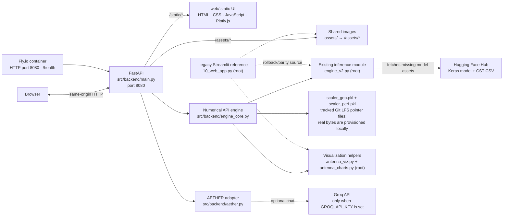

# System architecture

The production service is a single FastAPI process on port 8080. It serves the browser application and API from the same origin; the legacy Streamlit source is retained separately for rollback/parity purposes.

## Runtime paths

- `src/backend/main.py` owns FastAPI routes, synchronous engine startup, static serving, health reporting, and validation/API orchestration.
- `src/backend/engine_core.py` contains the API-side numerical functions and loads the unchanged root-level `engine_v2.py` module.
- `src/backend/aether.py` calls Groq only when a server-side `GROQ_API_KEY` is configured.
- `web/` is mounted at `/static`; root `assets/` is mounted at `/assets`. These URLs are same-origin with the API.
- The Docker image downloads the model and CST CSV during build. The scaler paths are checked at build time and must contain genuine local scaler bytes for a usable engine; committed Git LFS pointer text is not pickle data.
- Fly.io uses internal port 8080 and the `/health` HTTP check defined in `fly.toml`.
