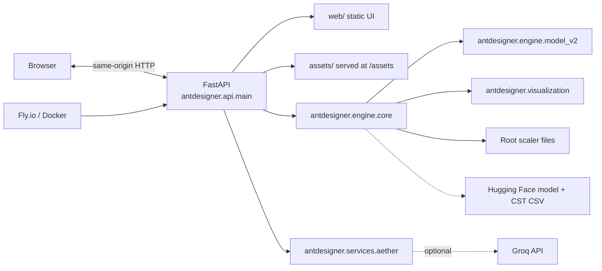

# Architecture

The production service is a single FastAPI process on port 8080. It serves the static browser UI and API from the same origin. The retired Streamlit interface is not part of this repository; a pre-cleanup Git tag is the intended recovery point for that source.

## Runtime paths

- `src/antdesigner/api/main.py` owns FastAPI startup, API routes, health reporting, validation jobs, and static serving.
- `src/antdesigner/engine/core.py` loads the numerical engine, root-level scaler paths, external model/data, and orchestrates predictions and validation.
- `src/antdesigner/engine/model_v2.py` contains the trained-model inference helper.
- `src/antdesigner/visualization/` serves API-generated antenna and Plotly visuals.
- `src/antdesigner/services/aether.py` contacts Groq only when `GROQ_API_KEY` is set.
- `web/` is mounted at `/static`; `assets/` is mounted at `/assets`.
- Docker downloads the Keras model and CST CSV during build. It expects authentic scaler pickle files at the project root and rejects unresolved LFS pointer contents.
- Fly uses internal port 8080 and the `/health` check in `fly.toml`.

Route paths and request/response contracts are owned by `api/main.py`; frontend calls are in `web/js/app.js`.
